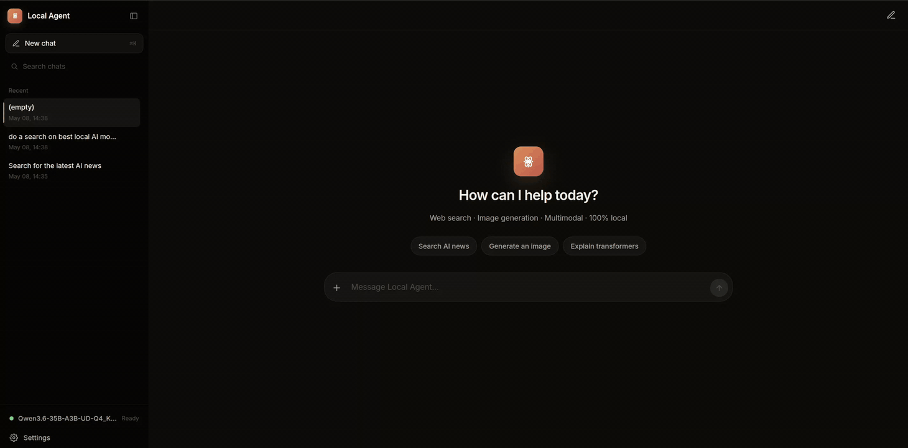
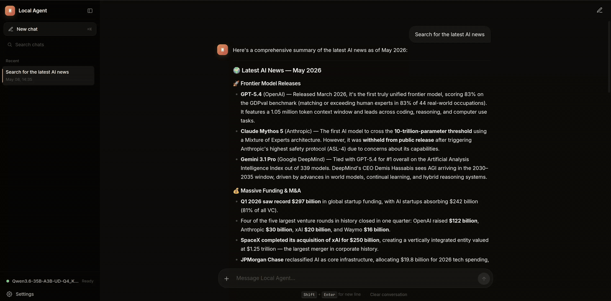

# lanGen - Personal LAN AI Agent

A self-hosted chat agent that runs on your local network. Run it on one machine, then open `https://<your-ip>:7000` from any device on your LAN - phone, laptop, tablet - and get a full AI assistant backed by a local LLM, web search, image generation, image editing, and image-to-video. Chat inference and storage stay local, with no model API keys required. Web search and page fetching use the internet.

---

## Demos

**Basic chat - "what can you do?"**



**Web search in action**



---

## Features

- **Local LLM** via [llama.cpp](https://github.com/ggerganov/llama.cpp) (OpenAI-compatible API)
- **Web search** - DuckDuckGo with parallel multi-query deep research
- **Page fetching** - reads full URLs and extracts main content (trafilatura + html2text)
- **Image generation** - text-to-image via ComfyUI workflows
- **Image editing** - img2img editing with Flux 2 Klein 4B
- **Image-to-video** - animate any image with WAN 2.2 14B
- **Multimodal input** - attach images or PDFs to any message
- **Thinking/reasoning display** - renders `<think>` blocks from Qwen3/DeepSeek models
- **Background tasks** - generation continues even if you switch tabs
- **Session persistence** - chat history stored as local JSON files
- **PWA** - installable on mobile; works offline for the shell
- **Self-signed TLS** - auto-generated cert with proper SANs for LAN access

---

## Requirements

- **Linux** (setup wizard is Linux-only for now)
- Python 3.12+
- [uv](https://docs.astral.sh/uv/) (`pip install uv` or `curl -LsSf https://astral.sh/uv/install.sh | sh`)
- NVIDIA GPU + CUDA drivers (recommended), AMD GPU (Vulkan), or CPU-only
- [ComfyUI](https://github.com/comfyanonymous/ComfyUI) installed somewhere on your machine *(optional - required only for image/video generation)*

You do **not** need to download llama.cpp or a model yourself - the setup wizard handles both.

---

## Quick start

```bash
git clone https://github.com/your-username/lanGen
cd lanGen
uv sync
uv run python setup.py     # interactive wizard - picks GPU, downloads llama.cpp + model
uv run python agent.py     # starts the server (llama-server is launched automatically)
```

Then open `https://<your-LAN-ip>:7000` from any device on your network.

> Your browser will warn about the self-signed cert. Click **Advanced → Proceed**. The cert is generated on first run in `certs/` and includes SANs for `localhost` and all detected LAN IPs.

---

## What `setup.py` does

The wizard is interactive and walks through:

1. **GPU detection** - finds NVIDIA / AMD / Intel Arc GPUs and checks CUDA driver status. Falls back to CPU if no GPU is available. If CUDA drivers are missing on an NVIDIA system, it prints install instructions and exits so you can install them.
2. **llama-server binary** - looks for an existing binary on `PATH` or in `./bin/`. If none is found, downloads the latest prebuilt release from [llama.cpp on GitHub](https://github.com/ggml-org/llama.cpp/releases), picking the CUDA / Vulkan / CPU build that matches your hardware, and extracts `llama-server` into `./bin/`.
3. **Language model** - scans `./models/` for existing `.gguf` files. Offers to use one, point to a model elsewhere on disk, or download a fresh Qwen3 model from Hugging Face:

   | Model | Quant | Size | Notes |
   |---|---|---|---|
   | Qwen3-1.7B | Q8_0 | ~2 GB | fast, small |
   | Qwen3-4B   | Q6_K | ~3.5 GB | balanced |
   | **Qwen3-8B** | Q4_K_M | ~5 GB | **recommended ★** |
   | Qwen3-14B  | Q4_K_M | ~9 GB | |
   | Qwen3-32B  | Q4_K_M | ~20 GB | best quality |

4. **Vision (optional)** - asks for an `mmproj` file path if you want multimodal/vision support (attach images and have the model see them).
5. **ComfyUI** - searches common paths (`~/ComfyUI`, `/opt/ComfyUI`, etc.), or lets you point to an existing install, or skip if you don't want image/video features.
6. **Writes `lanGen.ini`** with all the values you picked.
7. **ComfyUI workflow models (optional)** - offers to download the large model files used by the included workflows (Z-Image Turbo, Flux 2 Klein 4B, WAN 2.2 14B). You can defer this and run `uv run python setup.py --models` later.

Re-running `setup.py` is safe - it shows your current `lanGen.ini` values as defaults so you can update individual pieces without redoing everything.

To download just the workflow models without rerunning the full wizard:

```bash
uv run python setup.py --models
```

---

## Run

```bash
uv run python agent.py
```

With `managed = true` in `lanGen.ini` (the default), `agent.py` will:

1. Generate a self-signed TLS cert in `certs/` (first run only)
2. Launch `llama-server` with your configured model and wait up to 60 s for it to be ready
3. Launch ComfyUI if configured
4. Start the FastAPI server on `0.0.0.0:7000`

On shutdown (`Ctrl+C`), both managed subprocesses are terminated cleanly.

If you'd rather run llama-server or ComfyUI yourself, set `managed = false` in the relevant section of `lanGen.ini` - `agent.py` will skip spawning and just connect to the configured port.

### Logging

```bash
LOG_LEVEL=DEBUG uv run python agent.py
```

Managed subprocess logs are written to `logs/llama-server.log` and `logs/comfyui.log`.

---

## ComfyUI Workflows

Image and video generation is driven by ComfyUI workflows stored in `comfy_workflows/`. Each workflow is a pair of files:

```
comfy_workflows/
  my_workflow.json       # ComfyUI API-format workflow
  my_workflow.yaml       # sidecar: tool name, description, parameters, output type, downloads
```

The YAML sidecar defines how the workflow is exposed as an LLM tool. lanGen reads all pairs at startup and registers them automatically - no code changes needed to add a new workflow.

### Included workflows

| Workflow | Model | Use case |
|---|---|---|
| `text_to_image_zturbo` | Z-Image Turbo (4-step) | Text-to-image generation |
| `image_flux2_klein_image_edit_4b_base` | Flux 2 Klein 4B | Edit/restyle an existing image |
| `video_wan2_2_14B_i2v_subgraphed` | WAN 2.2 14B FP8 + LightX2V | Animate a still image into video |

The required model files for each workflow are declared in the `downloads:` block of the corresponding YAML. `setup.py --models` reads those blocks, checks what's missing under your ComfyUI install, and downloads them from Hugging Face into the right directory.

---

## Architecture

```
agent.py          FastAPI backend - agentic loop, session management, TLS, process spawning
comfy.py          ComfyUI workflow registry, image upload/download, PDF extraction
setup.py          First-run wizard (GPU detection, llama.cpp + model installer)
index.html        Single-page frontend - SSE rendering, sidebar, settings
comfy_workflows/  ComfyUI workflow JSON + YAML sidecar pairs
bin/              llama-server binary (downloaded by setup.py)
models/           GGUF language models (downloaded by setup.py)
chats/            Session JSON files (auto-created, gitignored)
certs/            Auto-generated TLS certificate (gitignored)
logs/             Server logs (gitignored)
static/           CSS, JS, icons, generated images, uploaded inputs
```

### Request flow

1. Browser sends `POST /api/chat` with the full message history
2. Backend prepends the system prompt (current date/time + tool routing instructions) and calls llama.cpp over SSE
3. The model can call tools (`web_search`, `fetch_page`, ComfyUI workflows) across up to 50 iterations
4. Each iteration yields newline-delimited JSON events (`status`, `thinking`, `text`, `image`, `video`, `error`, `sources`) back to the frontend
5. The frontend renders tool status pills, progress bars, images, video, and markdown as events arrive

### Session persistence

Each session is a UUID-named JSON file in `chats/`. The frontend sends the full message history on every request; the backend saves a checkpoint after each tool call round and after the final reply. Sessions are tracked via a `session_id` cookie (1-year expiry).

---

## `lanGen.ini` reference

Written by `setup.py`; you can hand-edit it afterwards. The most useful fields:

```ini
[llama]
binary       = ./bin/llama-server        ; absolute or relative path
model        = ./models/Qwen3-8B-Q4_K_M.gguf
mmproj       =                            ; optional, for vision models
gpu_layers   = 99                         ; -1 for all, 0 for CPU
ctx_size     = 8000
port         = 8080
managed      = true                       ; let agent.py start/stop llama-server

[comfyui]
workspace    = /path/to/ComfyUI
port         = 7860
python       = python3
managed      = true

[huggingface]
token        =                            ; only needed for gated repos
```

### Optional Parallel search and page fetching

DuckDuckGo remains the default, with pages fetched directly by lanGen. To use
[Parallel Search MCP](https://docs.parallel.ai/integrations/mcp/search-mcp), add
this section to `lanGen.ini` and restart `agent.py`:

```ini
[search]
provider = parallel
```

The existing `web_search` and `fetch_page` tools then use Parallel's hosted MCP
service at `https://search.parallel.ai/mcp`. Search runs in Fast mode, with no
account or API key required. This option sends search queries, requested URLs,
conversation identifiers, and the active model name to Parallel; inference and
chat storage stay local. Anonymous usage has service limits, and provider errors are returned to the
agent without switching to another backend. Page excerpts retain the existing
6,000-character content cap and source URLs.

Use `provider = duckduckgo` to restore direct search and page fetching, or
`provider = disabled` to prevent both research tools from making requests.
Omitting the section also selects DuckDuckGo. Re-running `setup.py` preserves the
search section.

---

## Development

```bash
uv sync                       # install deps
uv run ruff format .          # format
uv run ruff check .           # lint
uv run mypy agent.py comfy.py # type-check
uv run python -m unittest discover -s tests # research provider and agent-loop tests
```

---

## License

[MIT](LICENSE) © Yashasvi Asthana
